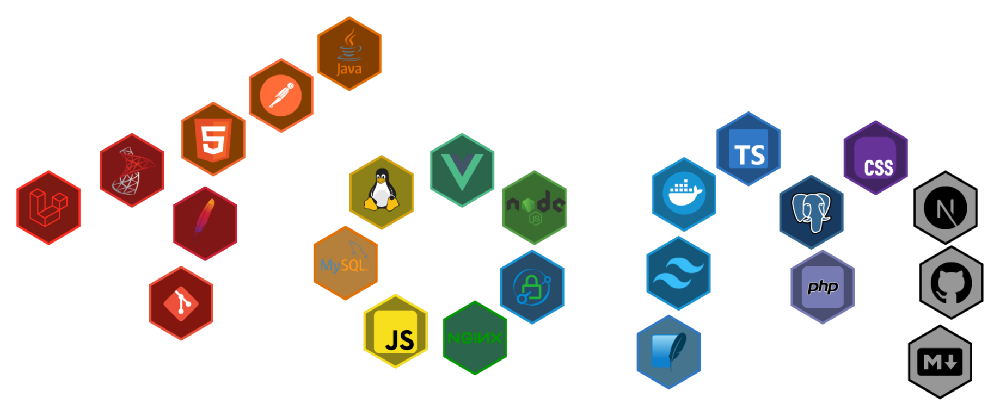
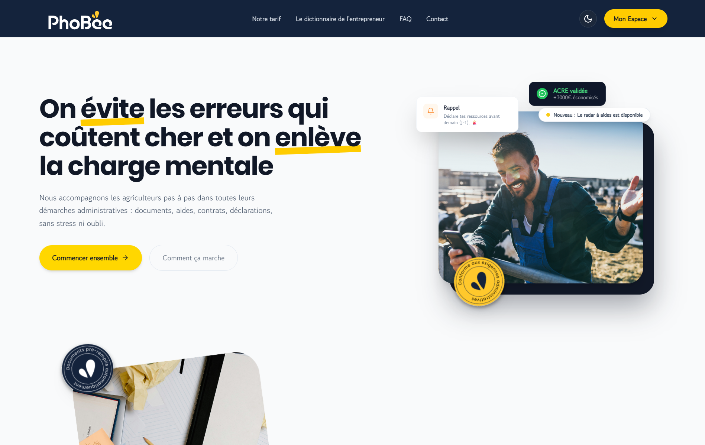
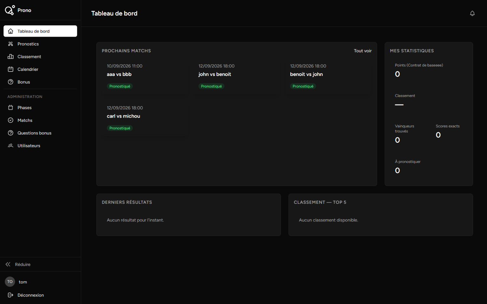

<h1 align="center">Tom.</h1>

  <code>// développeur full-stack — Angers, FR</code>

  Je construis des applis web solides avec <b>Laravel</b> &amp; <b>Vue.js</b> 
  et j'optimise ce qu'il y a sous le capot : les <b>bases de données</b>.

  
  
  
  

  

 

 

## `01` · En chiffres

  
  

  

 

## `02` · En ce moment

<table>
  <tr>
    <td width="50%" valign="top">
      
    </td>
    <td width="50%" valign="top">
      <h3>Phobee</h3>
      

        Projet interfilière de mon Master 2 à My Digital School. L'objectif est de créer un lot applicatif permettant de simplifier concrètement la gestion des documents administratifs agricoles grâce à une solution claire, accessible et adaptée au terrain.​
      

      
      
    </td>
  </tr>
  <tr>
    <td width="50%" valign="top">
      <h3>Ping Prono</h3>
      

        Application complète de gestion de pronostics pour mon club de Tennis de Table.
        Développée en PHP avec le framework Laravel et le moteur de templates Blade, elle permet aux membres du club de créer des pronostics sur les matchs de la saison.
      

      
      
    </td>
    <td width="50%" valign="top">
      
    </td>
  </tr>
</table>

## `03` · Me contacter

  
  

  <code>build manifest v1 — ~/tom █</code>

